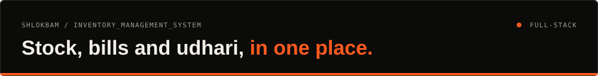
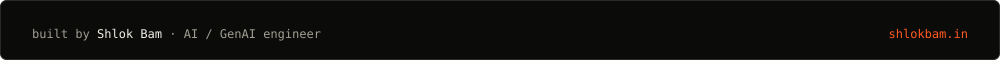

<div align="center">




<a href="https://ims-frontend-udaw.onrender.com/login">Live app</a> · <a href="#what-it-does">What it does</a> · <a href="#stack">Stack</a> · <a href="#run-it">Run it</a>

</div>

An inventory and billing app for a small shop: stock in batches, PDF invoices sent to customers on Telegram, and a ledger for credit (udhari). Runs on the web and as an Android app.

## What it does

- **Inventory:** products, categories and batches, with stock taken out first-in, first-out.
- **Billing:** a PDF invoice for every sale, sent to the customer over Telegram with a short text summary.
- **Ledger:** customer accounts, pending balances (udhari) and full transaction history.
- **Roles:** JWT sign-in with separate admin and staff permissions.
- **Reports:** sales and stock-level charts.
- **Mobile:** the same React app packaged for Android with Capacitor ([`mobile/app-debug.apk`](mobile/app-debug.apk)).

## Stack

| Area | Tools |
| :--- | :--- |
| API | FastAPI, SQLAlchemy, Pydantic, JWT |
| Web | React (Vite), Tailwind CSS, Recharts, Lucide icons |
| Data and hosting | PostgreSQL on Neon, Render |
| Messaging | Telegram Bot API |

## Run it

```bash
# backend · env: DATABASE_URL, SECRET_KEY, TELEGRAM_BOT_TOKEN
cd backend && pip install -r requirements.txt
uvicorn app.main:app --reload

# frontend · env: VITE_API_URL
cd frontend && npm install && npm run dev
```

Render deployment: [`deployment/render.yaml`](deployment/render.yaml) and [`deployment/deployment_instructions.md`](deployment/deployment_instructions.md).

---

<div align="center">

<a href="https://shlokbam.in"></a>

<a href="https://shlokbam.in">shlokbam.in</a> · <a href="https://www.linkedin.com/in/shlokbam/">LinkedIn</a> · <a href="https://github.com/shlokbam">More projects</a>

</div>
